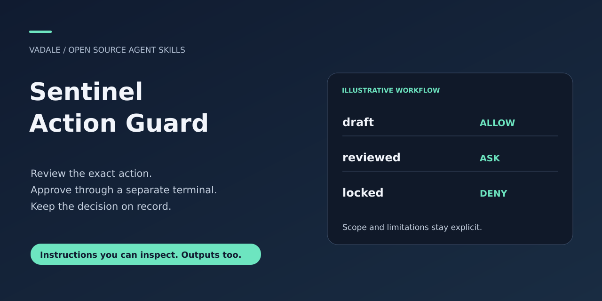
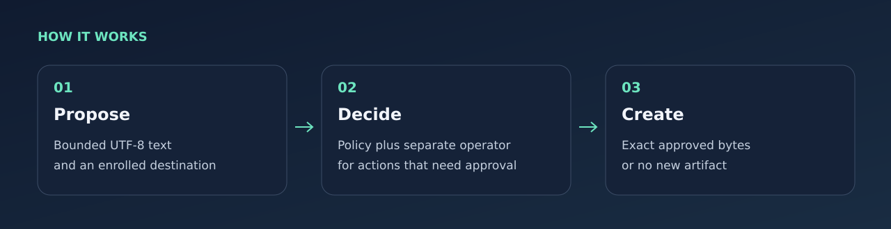

# Sentinel Action Guard



[Apache-2.0](LICENSE) · [Downloads](https://github.com/Vadale/sentinel-action-guard-skill/releases) · [Report a problem](https://github.com/Vadale/sentinel-action-guard-skill/issues)

Generate a report with an AI agent, review its exact bytes in a separate terminal,
and let the policy engine decide whether the artifact can be created.

For developers and analysts who want a small, inspectable approval route for
agent-generated text deliverables. The skill supplies the workflow; existing
Project Guardian software enforces allow/ask/deny in the actual execution path.

```text
Agent → artifact MCP tools → Guardian policy + audit → bounded file executor
                                ↑
                     separate operator terminal
```

The first release supports Linux and enrolled UTF-8 text artifacts up to 16 KiB.
It does not sandbox an unrestricted agent or intercept its other tools. See
[boundaries and provenance](skills/sentinel-action-guard/references/boundaries.md).



## Try a natural request

Once this skill is installed and visible to your assistant, try:

> Prepare a short note from these facts, deliver it to the operator-enrolled reviewed slot through Sentinel, and check the readback.

Bounded text routed through the enrolled MCP tools; delivery is reported only after an actual successful receipt, with pending or denied outcomes kept explicit.

See the [synthetic input/output example](examples/natural-request.md) for expected
behavior and nearby tasks that need another workflow. Automatic selection
depends on your host and model; explicit invocation remains available.

## Install in Codex

Ask the built-in installer:

```text
$skill-installer install https://github.com/Vadale/sentinel-action-guard-skill/tree/main/skills/sentinel-action-guard
```

Or copy the complete [skills/sentinel-action-guard](skills/sentinel-action-guard) folder into
`~/.agents/skills/`. Preserve its license and linked resources. Codex detects
installed skills automatically; if it does not appear, restart Codex.
[Official skill guide](https://learn.chatgpt.com/docs/build-skills).

Installing the skill copies instructions and runtime source. It does not build
the engine, start an operator/server or configure an MCP client. Follow setup below.

## Start locally

Prerequisites: Python 3.11+, Rust/Cargo, C compiler/linker, Linux `/proc`, Unix
sockets and a terminal. Engineering target: Rust/Cargo 1.99.1. First build needs
crates.io access; runtime requires no model service, API key or keychain setup.

Start from the source checkout (the source release ZIP is an alternative):

```sh
git clone https://github.com/Vadale/sentinel-action-guard-skill.git
cd sentinel-action-guard-skill
SKILL="$PWD/skills/sentinel-action-guard"
```

Choose new absolute local paths for the build and artifact store:

```sh
python "$SKILL/scripts/sentinel.py" build /absolute/new/sentinel-build
python "$SKILL/scripts/sentinel.py" init /absolute/new/sentinel-store
python "$SKILL/scripts/sentinel.py" operator \
  --root /absolute/new/sentinel-store \
  --engine /absolute/new/sentinel-build/target/debug/sentinel-engine
```

Keep that operator terminal open. Its startup JSON contains a fresh `command`
array: have your MCP stdio client launch that executable and arguments. The
client/agent uses its own terminal/process. This is a generic subprocess route;
no named GUI integration or automatic global configuration is provided.

Load [the skill](skills/sentinel-action-guard/SKILL.md) in your skill-capable
client, or use its instructions as project guidance. To install it manually,
copy **only** `skills/sentinel-action-guard` into a skill directory supported by
your client. Installing instructions does not start the operator or engine.
[Operator setup](skills/sentinel-action-guard/references/operations.md) explains
enrollment, connection, review and recovery. A small client can follow the
[wire contract](skills/sentinel-action-guard/references/protocol.md).

Default write destinations:

| Slot | Effect |
| --- | --- |
| `draft` | Create `draft.md` automatically |
| `reviewed` | Create `reviewed.md` only after the separate operator approves exact bytes |
| `locked` | Deny creation |

All enrolled slots permit reads of existing bounded text files. Files are never
overwritten. The operator can choose different slots before startup; their names
are not permission claims.

## Try a useful task

> Use $sentinel-action-guard. From these facts, prepare a short incident note:
> the batch began at 09:00, stopped at 09:12 after an input validation failure,
> and no retry has been authorized. Distinguish observations from unknown causes.
> Deliver it to the operator-enrolled reviewed slot and verify the readback.

The operator sees the complete proposed text, destination, byte count, SHA-256
and a fresh challenge. Only the separate terminal can authorize it. Refusing,
letting it expire or disconnecting before commit leaves no new artifact. A lost
response after commit may mean delivery happened: inspect before retrying.

## Checks and limits

After building, run the included real-route smoke check:

```sh
python tests/smoke.py --engine /absolute/new/sentinel-build/target/debug/sentinel-engine \
  --work /absolute/new/sentinel-smoke
```

It creates a synthetic store, a scripted operator PTY and an MCP bridge. It
checks actual allow/readback, denied write, approval pending before commit and
exact approved bytes. It is an engineering test, not a human approval study.
It may require local Unix-socket permission in a restricted test environment.

There is no overwrite/delete, arbitrary shell execution, network mediation or
automatic content-sensitivity judgment. The operator reviews meaning; Guardian
enforces the enrolled decision. Same-user unrestricted access and all tools
outside this MCP route remain outside coverage. No external users have tested
this first integration.

Apache-2.0. [NOTICE](NOTICE) identifies the unchanged Guardian source and new
integration work. Cargo downloads separately licensed locked dependencies.

## Related workflows

[R analysis](https://github.com/Vadale/r-statistical-analysis-skill), [finding triage](https://github.com/Vadale/sec-graph-triage-skill), [personal AI-project feedback](https://github.com/Vadale/ai-project-coach-skill), [project resumption](https://github.com/Vadale/project-continuity-skill), [sharing review](https://github.com/Vadale/publication-fit-review-skill).
These are independent products; none is a required companion.
